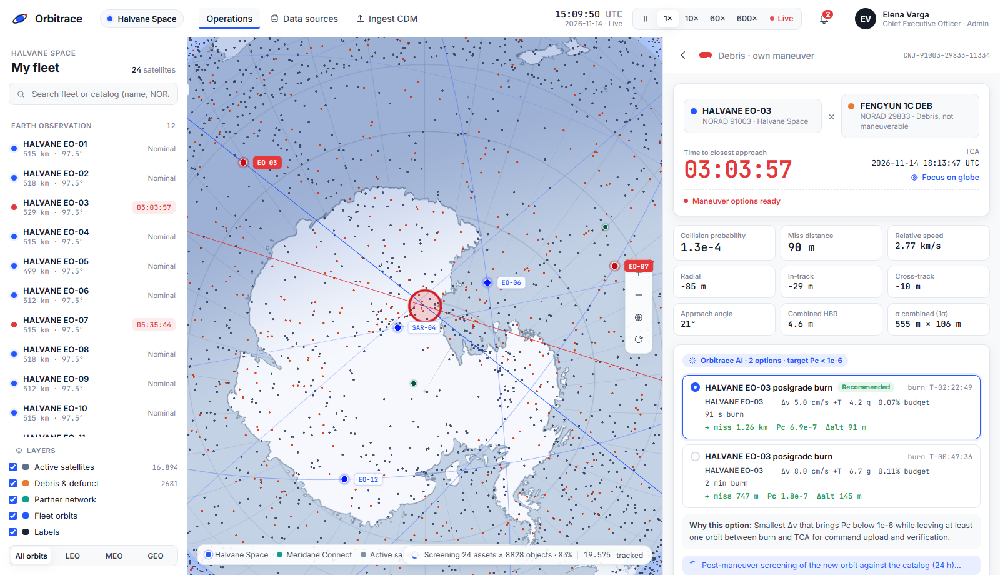

# Orbitrace: conjunction intelligence (demo)

Orbitrace is a dashboard for satellite operators. It fuses public and commercial tracking data into a single conjunction picture. It raises real-time collision alerts, and it computes avoidance maneuvers: for one satellite, or coordinated between two active satellites.

This repository is a **UX/UI demo**. It opens directly inside a client workspace. The client is **Halvane Space**, a fictional Earth-observation / SAR / IoT operator with 24 satellites, signed in as its CEO (admin). There is no login screen.





## What is real and what is simulated

| Part | Status |
|---|---|
| Public catalog (19,575 objects: 16,894 active payloads, Fengyun-1C, Cosmos-2251, Iridium-33 and Cosmos-1408 debris, ENVISAT) | **Real**: CelesTrak GP snapshot (OMM), propagated with SGP4 (`satellite.js`) |
| Earth, rotation (GMST), day/night terminator (Sun position) | Real geometry |
| Screening engine (apogee/perigee filter, range-rate sampling, golden-section TCA refinement) | Real computation, runs in a Web Worker |
| Collision probability (2D Foster-style integral over the hard-body circle) | Real computation; the **covariances are modelled** |
| CDMs (CCSDS 508.0-B-1, KVN) | Generated by the platform; can be downloaded and re-ingested |
| Halvane Space and Meridane Connect (partner operator) satellites | **Simulated** two-body orbits |
| Contractors X / Y / Z, partner ephemerides | Simulated feeds (placeholders for real providers) |
| "Orbitrace AI" maneuver engine | **Deterministic placeholder** for the future AI model: searches impulsive along-track burns, re-propagates, recomputes miss distance and Pc, then ranks by propellant and mission impact |

### How the alerts come about

When the session starts, some Halvane orbits are seeded so that they cross real catalog objects (real debris fragments, ENVISAT) or partner satellites at set times over the next 24 h. The screening engine then has to **find these encounters on its own**, alongside the real incidental close approaches against the rest of the catalog (about 50 under 5 km per day). Covered by `tests/scenario.test.ts`.

CDMs arrive over time to simulate feed latency. For example, the HALVANE SAR-01 × ENVISAT alert arrives as "Watch" (814 m). When Contractor X's radar data is fused it escalates to "Critical" (52 m).

## Implemented flows

- **Globe**: rotating Earth in a light style, all catalog objects (active / debris), the client fleet highlighted with labels and orbits, the partner network, zoom/rotate, click on any object, a tracking camera, LEO/MEO/GEO filters.
- **Real-time alerts**: prominent right panel with Critical/Warning/Watch/Monitoring counters, a critical banner on the globe, toasts, and an event log.
- **Alert detail**: TCA countdown, Pc and its trend across CDMs, RTN geometry, encounter plane with the covariance ellipse, data fusion (which feeds contributed), CDM history with the KVN viewer and download.
- **Active × passive (debris/defunct)**: "Compute avoidance maneuver" → AI steps → options (Δv, propellant, burn duration, budget %, predicted miss/Pc) → post-maneuver screening of the new orbit → "Send to Halvane Flight Dynamics" → acknowledgement → burn execution.
- **Active × active (partner)**: **automatic** coordination as soon as risk reaches the warning threshold. Joint solution with Δv split according to both missions' costs, proposal sent to the counterpart operator, acceptance, coordinated burns.
- **CDM ingest**: upload or paste a KVN CDM. If it involves a fleet satellite, an alert is created from the message's state vectors.
- **Time control**: live, pause, 10×, 60×, 600×.

## Running locally

```bash
npm install
npm run dev          # http://localhost:5173
npm test             # screening, severity, maneuver planner
npm run build        # static output in dist/
npm run data:fetch   # refresh the CelesTrak snapshot (public/data/catalog.json)
```

The scenario is rebuilt from the current time on every start, so the demo works on any date. To keep positions accurate, refresh the catalog with `npm run data:fetch` every few days.

## Structure

```
src/
  data/       catalog (OMM → SGP4), fictional client and partner, data feeds
  orbit/      kepler, screening, pc (collision probability), cdm (CCSDS 508), maneuver
  sim/        demo scenario, alerts/CDM issuance, screening engine
  workers/    propagator.worker (SGP4 of the whole catalog), engine.worker (screening)
  globe/      three.js scene (light Earth texture from Natural Earth, GPU points)
  state/      store: clock, alert lifecycle, maneuver workflow, log
  ui/         React components
scripts/fetch-catalog.mjs
tests/
```

## Next steps

- Replace `src/orbit/maneuver.ts` with the AI model (the `planAvoidance` interface is already isolated).
- Real ingestion from Space-Track (authenticated CDMs) and from the contractors' APIs.
- Real covariances (from CDMs / OD) instead of the sigma model in `src/sim/alerts.ts`.
- Authentication and multi-tenancy (each client sees only its own fleet).
