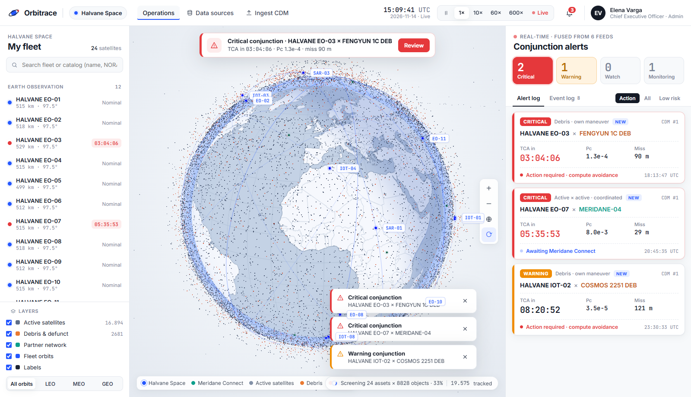
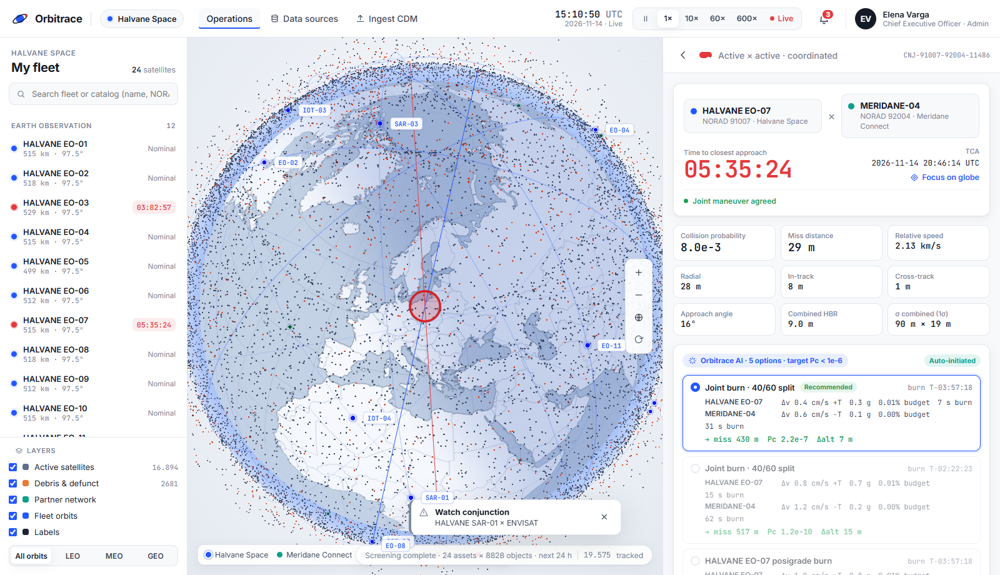

# NeoLEO: conjunction intelligence (demo)

NeoLEO is a dashboard for satellite operators. It fuses public and commercial tracking data into a single conjunction picture. It raises real-time collision alerts, and it computes avoidance maneuvers: for one satellite, or coordinated between two active satellites.

This repository is a **UX/UI demo**. It opens directly inside a client workspace. The client is **SVST26**, a fictional Earth-observation / SAR / IoT operator with 24 satellites, signed in as its CEO (admin). There is no login screen.





## What is real and what is simulated

| Part | Status |
|---|---|
| Public catalog (29,338 objects: 16,894 active payloads, 10,264 debris fragments, 2,180 rocket bodies and defunct objects incl. ENVISAT) | **Real**: CelesTrak GP snapshot (OMM), propagated with SGP4 (`satellite.js`) |
| Earth, rotation (GMST), day/night terminator (Sun position) | Real geometry |
| Screening engine (apogee/perigee filter, range-rate sampling, golden-section TCA refinement) | Real computation, runs in a Web Worker |
| Collision probability (2D Foster-style integral over the hard-body circle) | Real computation; the **covariances are modelled** |
| CDMs (CCSDS 508.0-B-1, KVN) | Generated by the platform; can be downloaded and re-ingested |
| SVST26 and SVST Singapore (partner operator) satellites | **Simulated** two-body orbits |
| All provider feeds except CelesTrak (LeoLabs, Slingshot, Space-Track, …), partner ephemerides, 10,000 synthetic debris fragments | Simulated (mock) |
| Per-object tracking & fusion (sensor visibility, obstructions, fused path, validation) | **Real computation on simulated observations**: geometry (GMST, Sun, Earth shadow, elevation, range) is real; the sensor measurements are simulated around the SGP4 path, seeded per object |
| "NeoLEO AI" maneuver engine | **Deterministic placeholder** for the future AI model: searches impulsive along-track burns, re-propagates, recomputes miss distance and Pc, then ranks by propellant and mission impact |

### How the alerts come about

When the session starts, some SVST26 orbits are seeded so that they cross real catalog objects (real debris fragments, ENVISAT) or partner satellites at set times over the next 24 h. The screening engine then has to **find these encounters on its own**, alongside the real incidental close approaches against the rest of the catalog (about 50 under 5 km per day). Covered by `tests/scenario.test.ts`.

CDMs arrive over time to simulate feed latency. For example, the SVST013 × ENVISAT alert arrives as "Watch" (814 m). When the simulated LeoLabs radar data is fused it escalates to "Critical" (52 m).

## Implemented flows

- **Globe**: rotating Earth in a light style, all catalog objects (active / debris), the client fleet highlighted with labels and orbits, the partner network, zoom/rotate, click on any object, a tracking camera, LEO/MEO/GEO filters.
- **Real-time alerts**: prominent right panel with Critical/Warning/Watch/Monitoring counters, a critical banner on the globe, toasts, and an event log.
- **Alert detail**: TCA countdown, Pc and its trend across CDMs, RTN geometry, encounter plane with the covariance ellipse, data fusion (which feeds contributed), CDM history with the KVN viewer and download.
- **Active × passive (debris/defunct)**: "Compute avoidance maneuver" → AI steps → options (Δv, propellant, burn duration, budget %, predicted miss/Pc) → post-maneuver screening of the new orbit → "Send to SVST26 Flight Dynamics" → acknowledgement → burn execution.
- **Manoeuvre profiles**: every plan surfaces four tagged choices: ★ Recommended (balanced score), ⛽ Lowest fuel (least propellant with Pc < 1e-6), 🛡 Safest (extra-margin search: Pc < 1e-8 and miss ≥ 1 km, lowest residual Pc), ⏱ Most lead time (earliest burn, most time to upload and verify). The chosen option explains why. `PROFILE_INFO` in `src/orbit/maneuver.ts`; asserted in `tests/maneuver.test.ts`.
- **Active × active (partner)**: **automatic** coordination as soon as risk reaches the warning threshold. Joint solution with Δv split according to both missions' costs, proposal sent to the counterpart operator, acceptance, coordinated burns.
- **Object tracking & fusion** (click any object): "Seen by N independent sources, fused by NeoLEO" (provider names are never shown, only sensor types), fused 1σ uncertainty now, 6 h chart of uncertainty vs true error with seen/blocked strip, four validation checks, "Where and how it was seen" (pass, sensor type, site, elevation, range, σ, rejected points with cause), and "Obstructions" (why a sensor missed the object). See [Tracking and fusion](#tracking-and-fusion).
- **Globe drag**: grab rotation, the ground point touched stays under the finger (Earth-fixed, also while time runs fast), north stays up, no inertia after release; pinch / wheel zoom. Measured headless: 80×40 px drag moves the ground 78×44 px, 0 px drift after release.
- **Top stack**: critical banner and notifications (e.g. manoeuvre accepted) share one column pinned under the top bar; alone, either sits at the top; together, notification under the banner.
- **Explain-on-tap metrics**: every metric label in alerts and the encounter view (Pc, miss distance, TCA, relative speed, radial / in-track / cross-track, approach angle, combined HBR, combined σ) shows a plain-language explanation on hover (desktop) or tap (phone), in a popup clamped inside the screen (flips above when there is no room below). Texts in `src/ui/Term.tsx`.
- **Filters** (Settings): object types (active satellites, debris fragments, rocket bodies, defunct satellites, with counts) and an altitude band in km (from / to, presets LEO 0–2,000, <450, 450–650, 650–1,200, all). An object shows if its orbit (perigee to apogee) crosses the band; your fleet and partners are always shown. Saved in the browser. `objectVisible` in `src/data/catalog.ts`.
- **Colours**: Settings → Colours lets each user pick the globe colours for their fleet, active satellites, debris, rocket bodies & defunct, and partners (saved in the browser; "Reset to brand colours").
- **Fleet ⋯ menu**: Ingest CDM, API access (documented REST endpoints + webhooks; demo, not live), Data sources. Also the way to reach these on phones.
- **CDM ingest in three steps**: 1 *Validate* (CCSDS 508 structure and sanity: version, header, TCA, miss distance, Pc in 0–1, two objects, state vectors and plausible radius, RTN covariance, unrecognised lines; errors block, warnings allow), 2 *Parse* (message, objects, TCA, miss, relative speed, Pc), 3 *Ingest* (alert or fusion into the existing one). `validateCdm` in `src/orbit/cdm.ts`, tests in `tests/cdm-validate.test.ts`.
- **CDM ingest**: upload or paste a KVN CDM. If it involves a fleet satellite, an alert is created from the message's state vectors.
- **Map & time bar** (one bar, bottom of the globe): zoom −/+, reset-and-rotate (one button: tap = reset the Earth view and auto-rotate, tap again = stop), map / satellite imagery, time **rewind ◀◀ / pause / faster ▶▶** (steps −3600× … −1×, 1× … 3600×), a "Now/Live" pill that returns to the current time, and Layers & settings. Tapping the clock in the top bar also returns to now.
- **Hard refresh**: hold the NeoLEO logo for 5 s (an Ember ring fills) to clear Cache Storage and service workers and reload from a fresh URL; user settings are kept. A toast confirms with the build stamp, also shown in Settings.
- **Top bar**: NeoLEO logo · UTC clock with live / paused / rewind state (tap = back to now) · tracked object chip (tap = camera tracking on/off).
- **Phones / iOS**: edge-to-edge with safe areas (notch, home indicator), translucent top and tab bars, Apple-style tab bar (49 pt like native iOS, tucked onto the home indicator; selected tab tints icon and label, others grey), white top/bottom bars with `theme-color` so Safari's address and tool bars match, home-screen web app (manifest, apple-touch-icon). Object details open as a draggable bottom sheet: peek (name + altitude · sources · uncertainty, globe stays visible), half, full; tap the header to toggle, drag down to close.

## Tracking and fusion

`src/orbit/tracking.ts` (engine), `src/ui/FusionPanel.tsx` (object-card block), `tests/tracking.test.ts`.

**1. Observations (simulated).** For the last 6 h (60 s steps), 12 ground sites (6 radar, 6 optical, grouped under 6 opaque source ids `S1`…`S6`) plus onboard GPS for active payloads look at the object. The "true" orbit is the SGP4 path plus a catalog-grade deviation (≈1 km along-track) that evolves with unmodelled acceleration. A site produces a point only if every check passes; otherwise the step is logged as an obstruction with its reason:

| Check | Radar | Optical |
|---|---|---|
| Elevation mask | 10° | 15° |
| Terrain sector (azimuth range below an elevation) | per site | per site |
| Max range | 3,000 km | 8,000 km |
| Site in darkness (Sun below −12°) | – | required |
| Object sunlit (not in Earth's cylindrical shadow) | – | required |
| Clear sky (30 % cloud chance per 30 min block) | – | required |

Point error is σ₀ / sin(elevation) (σ₀ = 50 m radar, 150 m optical, 10 m GPS). Below 20° elevation, 30 % of points also get an unmodelled 8σ refraction/multipath bias: the outliers the fusion must catch.

**2. Fusion: most probable path.** State = 6-D deviation from the catalog path in RTN, Clohessy-Wiltshire dynamics, catalog prior (σ 0.3/1.0/0.3 km, bounded relative motion), process noise 5·10⁻¹⁰ km/s². Forward Kalman filter (Joseph form) + Rauch-Tung-Striebel smoother → the maximum-a-posteriori path with its covariance at every step. **Robust step:** fit, drop the single worst point whose post-fit residual exceeds χ²₃(99.7 %) = 14.16, refit, repeat. A one-shot innovation gate fails when the first point of a pass is the outlier (it pulls the track and then good points get rejected); refit-and-drop does not.

**3. Validation (shown in the card).**
- *Stated errors are honest*: mean normalised innovation squared ≈ 3 (3-D).
- *Independent sources confirm the path*: leave-one-source-out, the path rebuilt without a source must predict that source's points within 3σ.
- *Bad measurements removed*: count of rejected points; each pass lists its rejections and likely cause.
- *Truth check (simulation only)*: RMS error vs best single source and vs catalog only, and share of time the truth is inside the 3σ ellipsoid.

**Test results** (`tests/tracking.test.ts`, 6 orbits): all 51 injected outliers caught, 1 good point dropped; fused error 3–59 m vs 3–122 m best single source vs 480–3,400 m catalog only; truth inside 3σ 100 % of the time (the band is slightly conservative); held-out sources agree ≥ 96 %. One object takes 0.1–0.3 s; the card caches one report per object per 30 min of simulated time.

**Limits.** HCW is a linearisation valid for a few hours and small deviations; observations are 3-D positions with isotropic σ (real radar gives range/angles, optical gives angles only); Sun position is low-precision; sites are generic. For production: replace the simulated feed with real tracks/CDMs (Space-Track/TraCSS basic data, customer ephemerides, licensed commercial data), use full measurement models and numerical propagation, keep the robust fit and the validation. Showing site coordinates can reveal a provider for well-known facilities: round to a region if identities must stay hidden.

## Brand

NeoLEO brand kit v1.0 (Deep Navy + Ember). Tokens in `src/styles.css` `:root`: Deep Navy `#14275E` (brand, buttons, selection), Ember `#EE7414` on light / `#FF8A2A` on dark (own fleet, rewind state, accents), Abyss `#070D20` (text), Chalk `#F4F2EE` (background), Navy 50–900 scale for surfaces, lines and secondary text. On the globe (defaults, changeable in Settings → Colours, validated for colour-blind separation): own fleet Ember `#EE7414`, active satellites blue `#2A78D6`, debris magenta `#C2368F`, rocket bodies & defunct light magenta `#E87BA4`, partners aqua `#1BAF7A`; status colours (critical/warning/watch) unchanged. Logo symbol is inlined (`LogoMark`), wordmark, favicon and app icons are in `public/brand/`. Satellite-imagery mode has no ocean sun glint.

## Running locally

```bash
npm install
npm run dev          # http://localhost:5173
npm test             # screening, severity, maneuver planner, tracking fusion
npm run build        # static output in dist/
npm run data:fetch   # refresh the CelesTrak snapshot (public/data/catalog.json)
```

The scenario is rebuilt from the current time on every start, so the demo works on any date. To keep positions accurate, refresh the catalog with `npm run data:fetch` every few days.

## Structure

```
src/
  data/       catalog (OMM → SGP4), fictional client and partner, data feeds
  orbit/      kepler, screening, pc (collision probability), cdm (CCSDS 508), maneuver, fusion (CDM covariance intersection), tracking (multi-source fusion + validation)
  sim/        demo scenario, alerts/CDM issuance, screening engine
  workers/    propagator.worker (SGP4 of the whole catalog), engine.worker (screening)
  globe/      three.js scene (light Earth texture from Natural Earth, GPU points)
  state/      store: clock, alert lifecycle, maneuver workflow, log
  ui/         React components
scripts/fetch-catalog.mjs
tests/
```

## Next steps

- Replace `src/orbit/maneuver.ts` with the AI model (the `planAvoidance` interface is already isolated).
- Real ingestion from Space-Track (authenticated CDMs) and from the contractors' APIs.
- Real covariances (from CDMs / OD) instead of the sigma model in `src/sim/alerts.ts`.
- Feed real observations into `trackObject` and draw sensor sight lines on the globe for the selected object.
- Authentication and multi-tenancy (each client sees only its own fleet).
